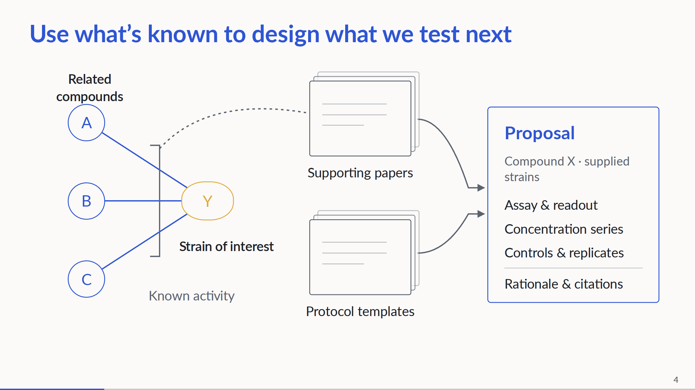

# What we test next

**Evidence-grounded experiment design** · Team Zhang et al. · Nucleate Pittsburgh BioHack 2026

A researcher has a compound, a biological target, and a question. If existing evidence answers it, return the
result. If the measurement is missing, help design the experiment that would answer it—with the evidence behind
the assay choice, concentration range, controls, and procedure available for review.

[View the slides](https://zhang-etal-biohack.pages.dev/) ·
[Explore the knowledge graph and benchmark cases](https://zhang-etal-biohack.pages.dev/talks/biohack/graph/)

[](https://zhang-etal-biohack.pages.dev/)

*Evidence and protocol templates inform the proposal. The bacterial diagram illustrates the workflow; it is not a recorded end-to-end run.*

## How it works

1. **Check the evidence.** Resolve the compound and target, then check whether the knowledge base already contains the measurement.
2. **Design the missing experiment.** Use related compounds’ measured activity and applicable protocol templates to propose an assay, concentration series, controls, and replicates with a rationale and supporting references.
3. **Prepare for execution.** The execution component checks supplied proposals against lab constraints and generates plate layouts, human-readable instructions, and Opentrons OT-2 protocols for simulation.

The current agent path uses kinase inhibition measurements (IC50). Bacterial MIC evidence and a separately
simulated bacterial execution example are also included; that example starts from a hand-written proposal.
Connecting those bacterial components into one agent-driven workflow remains integration work.

## Explore the work

- [Agent](agent/): graph lookup, related-compound retrieval, template selection, and structured proposals.
- [Knowledge graphs](kg/): biological measurements and protocol knowledge with source information.
- [Benchmarks](benchmark/): held-out cases, recorded model outputs, and checks of experiment choice, procedure, and numerical consistency.
- [Execution](execution/): lab constraints, plate planning, protocol generation, and simulation.
- [Watch the OT-2 hardware run](https://zhang-etal-biohack.pages.dev/media/ot2-run-demo.mp4): 27-second video of the team’s liquid-handling demonstration.

## OT-2 hardware demonstration

[](https://zhang-etal-biohack.pages.dev/media/ot2-run-demo.mp4)

[Watch the 27-second run](https://zhang-etal-biohack.pages.dev/media/ot2-run-demo.mp4).

## Layout

Each workstream owns a folder; folders exchange files whose formats are fixed in `wwtn/schema.py` (JSON Lines)
and [kg/README.md](kg/README.md) (graph CSVs). Read [CONTRIBUTING.md](CONTRIBUTING.md) before your first push.

Private brainstorming notes (`HANDOFF.md` and `DISCUSSIONS.md`) are local-only and ignored by Git.
Back up existing copies outside the repository before pulling the commit that removes them from tracking.
Earlier versions remain in Git history; this cleanup does not erase them.

```
screening/        upstream: which species does a candidate compound inhibit? (plan + plumbing, no data yet)
benchmark/        questions the KB can't answer (held-out facts), ground truth, grading
kg/biology/       biology KG: compounds, targets, target classes, known activities
kg/protocols/     protocol KG: dose-response templates (steps, parameters, labware), BAO-tagged
agent/            aim 1: question -> "can the KB answer it?" -> ExperimentProposal
execution/        aim 2: ExperimentProposal -> OT-2 protocol -> simulator (and the real robot)
Opentrons/        hand-written reference OT-2 protocols (Emmy): script + written protocol
wwtn/             shared code: llm.py (Nebius calls), schema.py (the data contracts)
slides/           the presentation (live deck)
```

```
screening/  (upstream: ranks candidate compounds; see screening/README.md)
                                |
benchmark/questions.jsonl --> agent/ <-- kg/biology/graph, kg/protocols/graph
                                |
                     agent/out/<run>.jsonl --> execution/ --> OT-2 protocol + simulation
                                |
                         benchmark/grade (against ground_truth.jsonl)
```

## Calling LLMs (Nebius Token Factory)

`wwtn/llm.py` wraps Nebius's OpenAI-compatible API. Put the key in `.env` (git-ignored; never commit it):

```bash
pip install -r requirements.txt
cp .env.example .env              # then fill in NEBIUS_API_KEY
python -m wwtn.llm --models       # the model IDs the key can use
python -m wwtn.llm "Suggest one follow-up experiment for a CRISPR knockout screen."
```

From Python: `from wwtn.llm import chat; chat("...", model="...", system="...", temperature=0.2)`. The default
model is `NEBIUS_MODEL` in `.env`.

## Slides

**Live deck:** https://zhang-etal-biohack.pages.dev/

- [Standalone Q/A](https://zhang-etal-biohack.pages.dev/talks/pitch-preview/qa.html)
